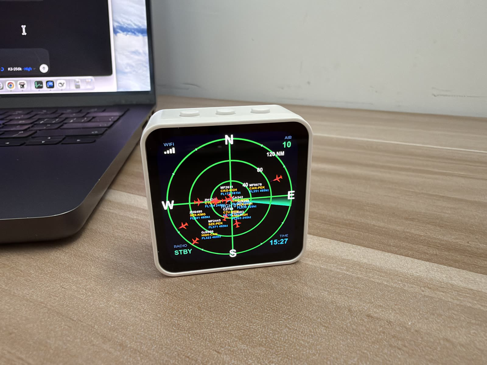

# ESP32 塔台雷达（语音播报版）

在一块 2.16 寸 AMOLED 圆屏上还原机场塔台雷达：实时显示头顶 120 海里内的航班，有飞机进入 30 公里圈时，自动用**塔台管制员的克隆音色**语音播报航班动态。



演示视频：[docs/demo.mp4](docs/demo.mp4)

## 效果

- 衰减余晖扫描、40/80/120 NM 距离环、罗盘刻度、萧山机场跑道磁方位线
- 飞机图标按真实航向旋转，带航班号 / 航线 / 高度 / 速度三色标签和速度矢量线
- 四角要素：WiFi 信号 / 在跟踪飞机数 / 时间 / 无线电状态（STBY 待命、TX 发射中，与声音严格同步）
- 进场航班触地即从雷达消失，过路航班巡航穿场而过——模拟真实塔台雷达行为

## 播报链路

```
航班进入 30km 圈
  → MiniCPM5-2B 生成塔台风格文案（每次措辞不同，8 种场景风格池）
  → 航空读法后处理（1→幺、2→两、7→拐、0→洞）
  → VoxCPM2 声音克隆（参考音色：真实塔台管制录音）
  → 0.9x 降速 + 300Hz~3kHz 带通 + 软削波电台音效
  → ES8311 功放播出，屏幕左下角 TX 同步点亮
```

MiniCPM5-2B（20 亿参数）和 VoxCPM2 均为面壁智能的端侧模型，整条"数据 → 文案 → 语音"链路都可以部署在自己的设备上。

## 硬件

- 微雪 [ESP32-S3-Touch-AMOLED-2.16](https://docs.waveshare.net/ESP32-S3-Touch-AMOLED-2.16)（ESP32-S3 + 480×480 AMOLED 圆屏 + 电容触摸 + ES8311 音频 Codec + 功放 + 锂电池接口）
- 外接小喇叭（板载功放直推）

## 数据来源

- 航班数据：飞常准航空数据 MCP 服务（`https://ai.variflight.com/servers/aviation/mcp`）
- 文案 / 语音：面壁智能 ModelBest 开放平台（`https://platform.modelbest.cn`）
- 演示模式：不联网不花 API 费用，本地模拟杭州萧山机场的进场 / 离场 / 过路航班（`flight_mgr.cpp` 中 `SIM_FLIGHTS`）

## 构建与烧录

```bash
# PlatformIO
pio run

# 烧录（端口按实际修改）
python3 ~/.platformio/packages/tool-esptoolpy/esptool.py \
  --chip esp32s3 --port /dev/cu.usbmodemXXXX -b 460800 \
  write_flash 0x10000 .pio/build/esp32-s3-amoled/firmware.bin
```

### 配置密钥

```bash
cp include/secrets.example.h include/secrets.h
# 编辑 secrets.h 填入飞常准和面壁智能的 API Key
```

### 配置克隆音色（可选）

自备一段单人讲话的参考录音（wav），转成 C 头文件：

```bash
ffmpeg -i ref.mp3 -ss 8.6 -to 17.6 -ar 16000 -ac 1 ref.wav
xxd -i ref.wav | sed 's/unsigned char ref_wav/static const uint8_t ATC_REF_WAV[] PROGMEM/; s/unsigned int ref_wav_len/static const unsigned int ATC_REF_WAV_LEN/' > src/atc_ref.h
```

并在 `announce.cpp` 中把 `ATC_REF_TEXT` 改成与录音对应的台词（提高克隆相似性）。不需要克隆音色时把 `ANN_USE_REF_VOICE` 设为 0 即可。

## 配网与 GPS

首次开机（或连不上 WiFi）设备会开启 `HGH-RADAR` 热点，手机加入后访问 `192.168.4.1`，在网页里填 WiFi 凭据和**雷达中心 GPS 坐标**（默认杭州萧山机场 30.2295, 120.4344），保存后自动重启生效。

## 致谢

- 雷达 UI 灵感：[micro-radar](https://github.com/AnthonySturdy/micro-radar)、[ESP32-Plane-Radar](https://github.com/RockBase-iot/ESP32-Plane-Radar)
- 全部固件代码由 [Kimi Code](https://www.kimi.com/code) 对话式开发完成
